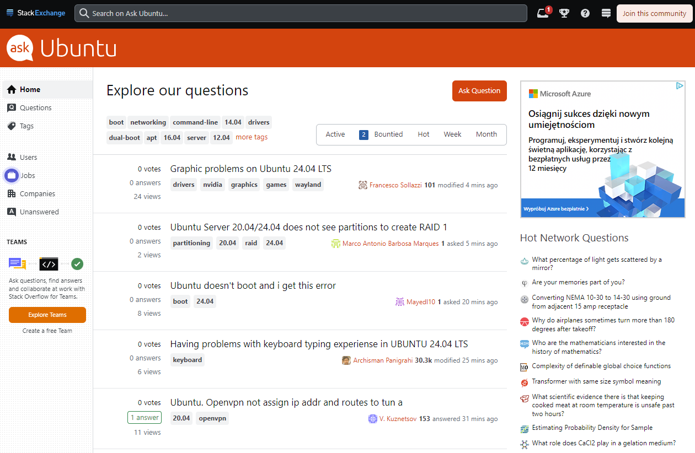
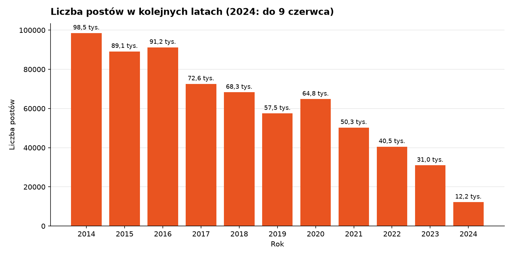
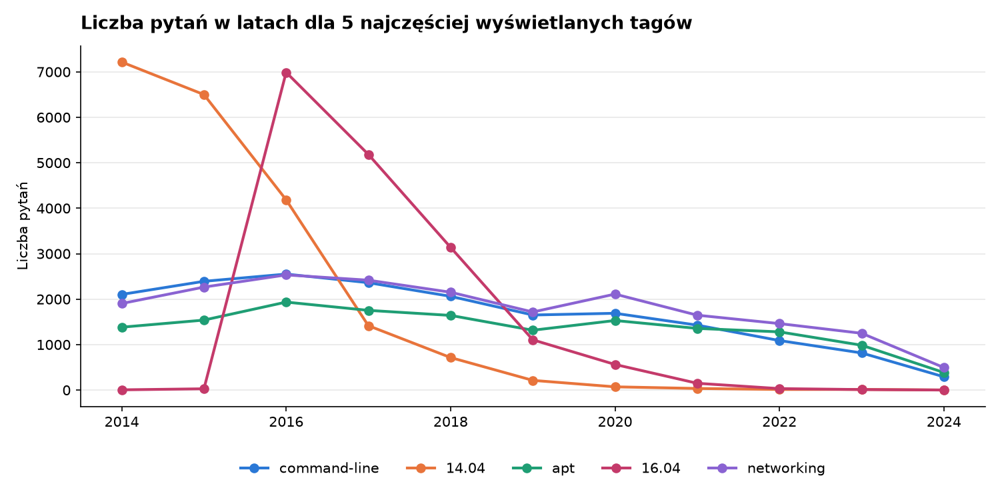
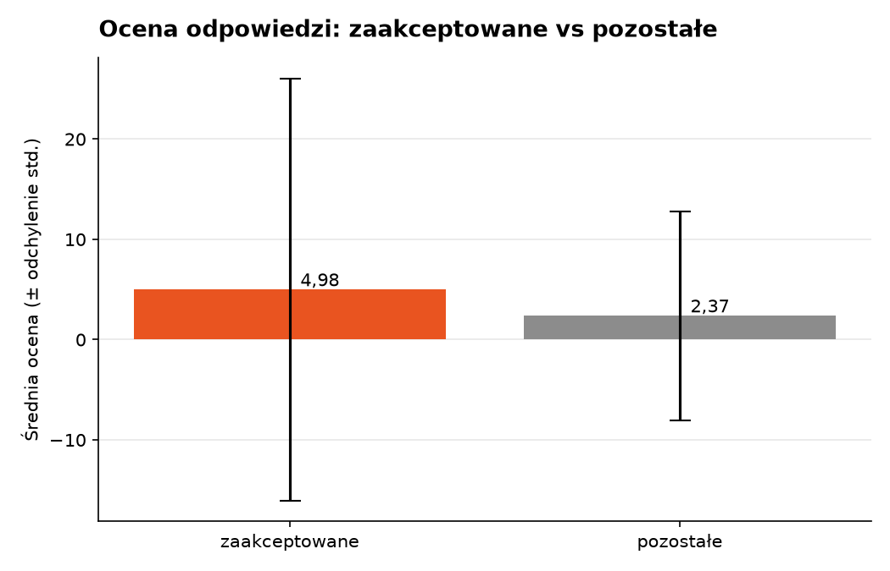

# Analiza aktywności użytkowników forum Ask Ubuntu: Big Data w chmurze AWS

Kod źródłowy pracy dyplomowej:
**„Analiza aktywności użytkowników i treści wybranego forum dyskusyjnego z wykorzystaniem technologii Big Data
w środowisku chmurowym Amazon Web Services”**
(Wydział Elektroniki i Technik Informacyjnych, Politechnika Warszawska, 2024).

**Technologie:** Python · Apache Spark (PySpark) · Amazon S3 · Amazon EMR · Amazon EC2 · AWS Cloud9 · EMR Notebooks (Jupyter) ·
boto3 · API Stack Exchange (OAuth 2.0) · pandas · Matplotlib · NLTK · Power BI

---

## Cel projektu

Celem pracy było przygotowanie w chmurze AWS rozwiązania, które:

1. pobiera dane z forum [askubuntu.com](https://askubuntu.com) przez API Stack Exchange,
2. przechowuje je w Amazon S3,
3. przetwarza je w Apache Spark na klastrze Amazon EMR,
4. odpowiada na 10 pytań analitycznych o aktywności użytkowników i treściach na forum,
5. udostępnia wyniki do raportu w Power BI.

## Architektura



1. **AWS Cloud9:** skrypt w Pythonie pobiera dane przez API Stack Exchange i zapisuje je jako pliki JSON
   w buckecie **Amazon S3**.
2. **Amazon EMR:** po uruchomieniu klastra (maszyny EC2) uruchamiany jest **EMR Notebook** z przygotowanym kodem.
   Spark wczytuje dane z S3, zamienia je na DataFrame'y i wykonuje przekształcenia oraz obliczenia.
3. Wyniki pojawiają się w notebooku jako wykresy (Matplotlib, pandas) lub liczby i są zapisywane w S3 jako pliki xlsx.
4. **Power BI:** skrypt w Pythonie pobiera wyniki z S3 na komputer lokalny, gdzie powstaje raport.

## Struktura repozytorium

```
.
├── 1_pobieranie_danych/              # uruchamiane w AWS Cloud9
│   ├── create_bucket.py              # utworzenie bucketu w Amazon S3
│   ├── download_data_from_api.py     # pobranie danych z API Stack Exchange -> pliki JSON w S3
│   └── combine_json.py               # połączenie plików rocznych w jeden plik na tabelę
├── 2_analiza_emr/                    # uruchamiane na klastrze Amazon EMR
│   ├── boto3_install.sh              # bootstrap action: instalacja bibliotek na klastrze
│   └── analiza_askubuntu.ipynb       # wczytanie danych, pytania analityczne a-j, zapis wyników
├── 3_raport/                         # uruchamiane lokalnie
│   └── download_results_from_s3.py   # pobranie wyników (xlsx) z S3 do Power BI
├── img/                              # schemat architektury i wykresy wyników
└── README.md
```

## Dane

* **Źródło:** forum [askubuntu.com](https://askubuntu.com), pobierane przez [API Stack Exchange](https://api.stackexchange.com/docs)
* **Okres:** 01.01.2014–09.06.2024
* **Dostęp:** OAuth 2.0 (konto i zarejestrowana aplikacja w Stack Apps)
* **Tabele:**

| Tabela | Zawartość |
|---|---|
| USERS | użytkownicy forum i metadane |
| POSTS | posty (pytania i odpowiedzi), autor, metadane |
| COMMENTS | komentarze do postów i metadane |
| QUESTIONS | pytania: tytuł, treść, tagi, ocena, liczba odpowiedzi i wyświetleń |
| ANSWERS | odpowiedzi: ocena, informacja o zaakceptowaniu, id pytania |

API zwraca maksymalnie 100 rekordów na stronę, dlatego dane pobierane są strona po stronie i osobno dla każdego roku.
Każda tabela pobierana jest w osobnej iteracji i zapisywana w osobnym pliku JSON.

## Pytania analityczne

| | Pytanie |
|---|---|
| a | Liczba postów na przestrzeni czasu |
| b | Czas na forum (od założenia konta do ostatniego posta/komentarza) 10 najdłużej aktywnych użytkowników |
| c | Porównanie najwyżej i najniżej ocenianych pytań (długość, tagi, liczba odpowiedzi) |
| d | Procent przypadków, kiedy najwyżej oceniana odpowiedź nie jest odpowiedzią zaakceptowaną |
| e | Rozkład ocen odpowiedzi zaakceptowanych i pozostałych (średnia, odchylenie, minimum, maksimum) |
| f | Top 5 tagów, które wygenerowały najwięcej wyświetleń |
| g | Liczba pytań w czasie dla każdego z top 5 tagów |
| h | Najczęściej pojawiające się słowa w tytułach (z pominięciem stopwords) |
| i | Procent użytkowników, którzy nigdy nic nie opublikowali |
| j | Średni czas od pojawienia się pytania do pojawienia się zaakceptowanej odpowiedzi |

## Wybrane wyniki

| Wynik | Wartość |
|---|---|
| Przeanalizowane posty | **675 949** (04.01.2014–08.06.2024) |
| Spadek liczby postów rocznie (2014 → 2023) | z **98,5 tys.** do **31 tys.** (−69%) |
| Średnia ocena odpowiedzi zaakceptowanych / pozostałych | **4,98** / **2,37** |
| Pytania z odpowiedziami, ale bez zaakceptowanej odpowiedzi | **61,42%** |
| Użytkownicy, którzy nigdy nic nie opublikowali | **82,08%** |
| Najdłużej aktywni użytkownicy | ok. **3 800 dni** (ponad 10 lat) |
| Top 5 tagów według wyświetleń | command-line, 14.04, apt, 16.04, networking |



Aktywność na forum spada od 2014 roku. Wyjątkiem jest rok 2020, w którym liczba postów wzrosła o 13% względem 2019.



Tagi wersji systemu (14.04, 16.04) mają wyraźny „cykl życia”. Pytania o daną wersję LTS osiągają szczyt w roku
jej wydania i niemal znikają po około 3 latach. Tagi tematyczne (command-line, networking, apt) są stabilne.



Odpowiedzi zaakceptowane mają średnio około 2 razy wyższą ocenę niż pozostałe. Rozkład jest bardzo nierówny:
odchylenie standardowe jest wielokrotnie większe od średniej, a pojedyncze odpowiedzi mają ponad 1 000 głosów.

## Uruchomienie

**1. AWS Cloud9: pobranie danych**

```bash
pip install boto3 requests
export SE_ACCESS_TOKEN="..."   # token OAuth 2.0 ze Stack Apps
export SE_KEY="..."            # klucz aplikacji ze Stack Apps

python create_bucket.py
python download_data_from_api.py
python combine_json.py
```

**2. Amazon EMR: analiza**

1. Wgranie `boto3_install.sh` do bucketu S3.
2. Utworzenie klastra EMR z aplikacjami Spark i JupyterEnterpriseGateway oraz wskazanie skryptu
   `boto3_install.sh` jako *bootstrap action*.
3. Utworzenie EMR Notebook podłączonego do klastra i uruchomienie `analiza_askubuntu.ipynb`
   (kernel PySpark).

**3. Komputer lokalny: raport**

```bash
python download_results_from_s3.py   # pobiera pliki xlsx z wynikami
```

Pobrane pliki stanowią źródło danych raportu w Power BI Desktop.

## Możliwe kierunki rozwoju

* Wczytywanie danych w Sparku bezpośrednio z S3 (`spark.read.json("s3://...")`), z pominięciem drivera.
* Zapis danych w formacie kolumnowym (Parquet) z podziałem na lata, co przyspiesza kolejne analizy.
* Automatyczne cykliczne pobieranie nowych danych (np. AWS Lambda lub Airflow).
* Pobranie danych sprzed 2014 roku, aby objąć całą historię forum (od 2010 roku).
